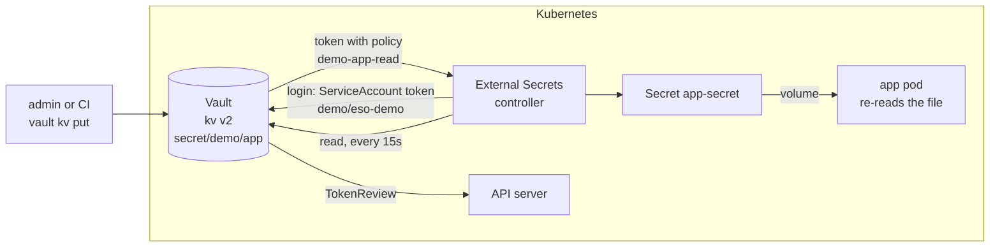

# vault-k8s-secrets

[](https://github.com/Walaskien/vault-k8s-secrets/actions/workflows/ci.yml)

A Secret manifest in Git is base64, not encryption. Anyone with a clone has the password, and after a rotation the old one is still in the history. This repo keeps the value out of Git altogether: HashiCorp Vault holds it, External Secrets Operator copies it into an ordinary Kubernetes Secret, and a small HTTP service reads that Secret. Change the value in Vault and the cluster follows within the refresh interval, with no commit and no pod restart.

> **Vault runs in dev mode here, for the demo only.** In-memory storage, no TLS, auto-unsealed, and a root token that is written in `helm/vault-dev-values.yaml` (`root`). Everything is gone when the pod restarts. [docs/real-mode.md](docs/real-mode.md) lists what a real install changes: storage, unseal, TLS, the root token, audit.

## How the pieces fit



The login is the interesting part. External Secrets asks the API server for a short-lived token of the ServiceAccount `demo/eso-demo` (audience `vault`) and sends it to Vault's Kubernetes auth method. Vault hands the token to the API server's TokenReview, and if the answer is "this is `eso-demo` in `demo`" it checks that against the role `demo-app`. The role is bound to exactly that name and namespace and carries one policy, `demo-app-read`:

```hcl
path "secret/data/demo/app" {
  capabilities = ["read"]
}
```

That is the whole policy: one path, read only. kv v2 stores the payload under `secret/data/...`, which is why the path says `data`. No list, no write, no `secret/metadata`. The token lives 15 minutes.

What is in the repo:

- `helm/`: values for the Vault chart (dev mode) and for External Secrets, plus a sketch of a real Raft/TLS install that only renders.
- `vault/policies/`: the two policies as files, so a change is a reviewable diff.
- `manifests/base/`: kustomize. Namespace, two ServiceAccounts, `SecretStore`, `ExternalSecret`, the app (a short Python HTTP server mounted from a ConfigMap) and its Service.
- `scripts/bootstrap-vault.sh`: kv v2, Kubernetes auth, policy, role, first value. Safe to run twice.
- `manifests/dynamic-db/` and `scripts/bootstrap-db.sh`: the extension, below.
- `scripts/e2e.sh`, `scripts/e2e-db.sh`, `tests/`: the checks that CI runs on kind, and a Docker-only test of the Vault side.

The app returns a fingerprint of the password (first 12 hex characters of sha256) and its length, never the value, so the answer is safe to print in a CI log.

## Rotation

```console
vault kv patch -mount=secret demo/app password=new-value
```

1. Vault writes kv v2 version 2.
2. The `ExternalSecret` has `refreshInterval: 15s`, so within that time External Secrets reads the new value and updates the Secret. 15 seconds is for the demo; the default is one hour, which is a fine number when an hour of delay is acceptable.
3. The Secret is mounted as a directory, and the app opens the file on every request. The kubelet refreshes the mounted files on its own sync period, so the pod sees the new value without a restart. The e2e script compares the pod UID and restart count before and after.

I chose the file-and-re-read way because it needs nothing else in the cluster. Two things it does not cover. A `subPath` mount never gets updated. And an app that reads an environment variable (`secretKeyRef`) at startup keeps the old value until it restarts. For that the usual answer is Reloader (a controller that restarts a Deployment when its Secret changes, annotation `reloader.stakater.com/auto: "true"`), or `kubectl rollout restart`. I did not add or test Reloader here.

## Extension: dynamic Postgres credentials

Instead of a stored password, Vault's database engine creates a Postgres user on request and drops it when the lease ends.

- `scripts/bootstrap-db.sh` gives Vault an admin connection, a role `app-ro` (the issued user is a member of a `SELECT`-only group, valid 15 minutes, one hour at most) and a policy that reads only `database/creds/app-ro`.
- A second ServiceAccount, `eso-db`, and a second Vault role, `app-db`, so the account that can read the static secret cannot mint database users, and the other way round.
- The External Secrets `VaultDynamicSecret` generator reads the credentials and an `ExternalSecret` puts them in the Secret `app-db-creds`. `refreshInterval: 5m` is shorter than the 15-minute TTL on purpose, otherwise the Secret would hold a dead password.

Two things to know before using it. Every refresh asks Vault for a new user. The generator's `Cleanup` in the External Secrets source is empty, so the previous users are not revoked early, they disappear when their TTL runs out. And the Postgres admin password that Vault uses is created by `scripts/deploy-db.sh`, kept in a cluster Secret and in Vault's connection config; `vault write -f database/rotate-root/postgres` would take it out of human hands, but I did not do that.

## Quick start

Needs docker, kubectl, helm, python3 and, for the cluster part, kind. The cluster commands install Vault in dev mode into whatever the current kubectl context is, so use a throwaway cluster.

```console
python3 -m venv .venv && . .venv/bin/activate && pip install -r requirements-dev.txt
make check            # yamllint, kubeconform, shellcheck, actionlint
make docker-test      # Vault and Postgres in plain Docker, no Kubernetes

kind create cluster --name vault-demo --config kind/kind-config.yaml
make deploy           # Vault (dev mode), External Secrets, bootstrap, demo app
make e2e
make deploy-db && make e2e-db
```

Poking at it by hand:

```console
kubectl -n vault exec vault-0 -- env VAULT_TOKEN=root vault kv patch -mount=secret demo/app password=changed
kubectl -n demo get secret app-secret -o jsonpath='{.data.password}' | base64 -d
kubectl get --raw /api/v1/namespaces/demo/services/app:http/proxy/
```

## What the e2e job checks

On a fresh kind cluster in GitHub Actions, in this order:

1. The ExternalSecret becomes Ready, the Secret holds the value that is in Vault, the Secret is owned by the ExternalSecret, the value appears in no tracked file, and the app reports the matching fingerprint.
2. Rotation: a new value in Vault reaches the Secret and then the app, with the same pod and restart count 0. The job prints how many seconds each step took.
3. A second `bootstrap-vault.sh` run does not reset the rotated value.
4. Least privilege. An ExternalSecret that asks for `secret/demo/other` (which exists) turns NotReady with a permission error and creates no Secret. Three pods log in with their own projected token: the right ServiceAccount gets a token, can read one path and is refused on another path, on a write, on a list and on metadata; another ServiceAccount in the same namespace is refused; the same ServiceAccount name in another namespace is refused. The tokens all have audience `vault`, so a refusal can only come from the role binding.
5. Extension: the issued user can `SELECT` and cannot create a table; a wrong password is rejected (control); revoking the lease removes the user; a forced refresh produces a different user; the kv reader's ServiceAccount is refused by the `app-db` role.

## Verified

Run on macOS (arm64), without a cluster. Docker was held by another job on this machine, so the linters ran as release binaries or pip packages of the same versions that `make check` pulls as images (kubeconform 0.7.0 and Vault 2.0.4 as release binaries with the sha256 checked against the published sums, not the signature). The repository had not been pushed when this was written.

| Check | Result |
|---|---|
| `yamllint -s .` (1.37.1) | no findings |
| kubeconform 0.7.0, strict, Kubernetes 1.34.0, External Secrets schemas from the datree catalog, on `kubectl kustomize manifests/base` (8 resources), `manifests/dynamic-db` (6), and `helm template` of Vault chart 0.34.1 with the dev values (6) and the Raft sketch (12) | all valid, 0 skipped. Controls: a misspelled field in a scratch copy of the ExternalSecret and of the SecretStore was reported as invalid |
| shellcheck 0.10.0, `-x scripts/*.sh tests/*.sh` | no findings |
| actionlint 1.7.12 | no findings |
| `scripts/bootstrap-vault.sh` twice against a dev-mode Vault 2.0.4 | exit 0 both times. The second run leaves the secret alone (version stays 1). A mount that exists as kv v1 is refused. A missing `VAULT_TOKEN` stops it with a message |
| the policy `demo-app-read` on a token with no other policies | read of `secret/demo/app` works. Read of `secret/demo/other`, write, list, `secret/metadata` and `auth/kubernetes/config` all return permission denied. After `vault kv patch` the reader sees the new value, the version is 2, and a third bootstrap run keeps it |
| `scripts/bootstrap-db.sh` twice, then dynamic credentials, against Vault 2.0.4 and a native Postgres 16.2 | an issued user (`v-...`) can `SELECT`, cannot `CREATE TABLE`, a wrong password is rejected (control), lease duration is 900 s, `vault lease revoke` removes the role from Postgres and the login stops working. The kv policy cannot read database creds and the database policy cannot read the kv secret |
| `manifests/base/server.py` run locally (Python 3.9) | the fingerprint equals the sha256 prefix of the file content, changes when the file is rewritten without restarting the process, `/healthz` is 200, a missing file gives 503 |
| `helm template` of the External Secrets chart 2.15.0 | the controller ClusterRole includes `create` on `serviceaccounts/token`, which the ServiceAccount login needs |

Not verified, and the reason:

- **Everything that needs a cluster.** The machine is too small to keep kind alive, so none of this has run yet: the e2e job, the External Secrets login to Vault with a ServiceAccount token (TokenReview included), how fast a rotation arrives (`scripts/e2e.sh` prints the seconds), the volume update in the kubelet, the `VaultDynamicSecret` generator, and the three access pods. The exact wording of Vault's refusal for a wrong ServiceAccount is a guess; the check accepts `403`, `permission denied` or `not authorized`. All of it is checked in CI only once CI has run, and it has not.
- **`make docker-test` as written.** The same Vault and Postgres checks ran against native processes, not through `docker run` and `docker exec`, so the Docker wrapper in `tests/docker-vault.sh` is untested here. The Postgres version differs too (16.2 here, 17.11 in the script).
- **`make check` through the pinned images**, for the reason above; the tool versions are the same.
- **GitHub Actions as a whole.** The workflow passes actionlint but has not run.

## Limitations

- Dev mode, plain HTTP and a public root token. That is the demo, not a setup to copy; see [docs/real-mode.md](docs/real-mode.md).
- The Secret ends up as a normal Kubernetes Secret: base64 in etcd, readable by anyone who can `get` secrets in the namespace. Encryption at rest of etcd is a cluster setting and not covered. A CSI driver or the Vault agent injector avoid the Kubernetes Secret, at the price of more moving parts in every pod.
- The `SecretStore` is namespaced, but every ExternalSecret in `demo` can use it. Whoever may create ExternalSecrets there can read `secret/demo/app`, so the boundary is namespace RBAC plus the policy.
- Tested versions only: Vault chart 0.34.1 (Vault 2.0.4), External Secrets chart 2.15.0 (API `external-secrets.io/v1`), kubernetes 1.34.11 in kind, Postgres 17.11. Vault 1.21 and later refuse Kubernetes logins when the role has no `audience`, which is why both sides set `vault`.
- The CRD schemas for kubeconform come from a public catalog on GitHub (datreeio/CRDs-catalog). If it goes away the lint job fails until the location is changed.
- One replica of everything, no network policies, no resource tuning. The demo Postgres has no volume.
- The images come from Docker Hub and ghcr.io. If Docker Hub rate-limits the runner the e2e job can fail on image pull and needs a re-run.

## Layout

```
helm/                 Vault dev values, External Secrets values, a Raft/TLS sketch (renders, not deployed)
vault/policies/       demo-app-read.hcl, app-db-creds.hcl
manifests/base/       kustomize: namespace, ServiceAccounts, SecretStore, ExternalSecret, app, Service
manifests/dynamic-db/ extension: Postgres, init.sql, ServiceAccount, VaultDynamicSecret, ExternalSecret
scripts/              bootstrap-vault.sh, bootstrap-db.sh, deploy*.sh, e2e*.sh, lib.sh
tests/                access-check.sh (runs in a pod), docker-vault.sh (Vault and Postgres in Docker)
kind/                 single-node cluster config
docs/real-mode.md     dev mode against a real install
Makefile              lint and test targets, linters from pinned images
.github/workflows/    ci.yml
```

## Related

- [k8s-security-baseline](https://github.com/Walaskien/k8s-security-baseline): RBAC, Pod Security and admission policies for the namespace this kind of app lives in.
- [gitops-argocd](https://github.com/Walaskien/gitops-argocd): with GitOps the ExternalSecret manifest belongs in Git and the value does not, which is the split this repo shows.
- [cicd-k8s-delivery](https://github.com/Walaskien/cicd-k8s-delivery): a small app delivered to a kind cluster from CI.
